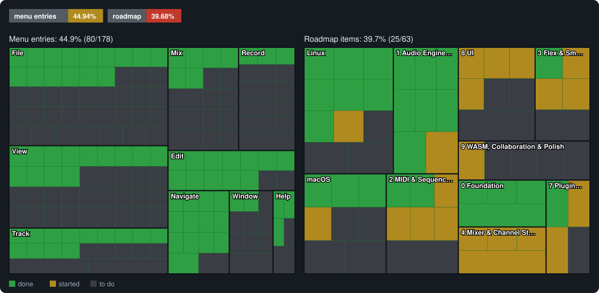

# Pro Wave

**ProWave** is an open-source music production DAW in pure Rust, with a look and
workflow modelled on Apple's Logic Pro. It is drawn entirely with [egui](https://github.com/emilk/egui)
and plays audio through [cpal](https://github.com/RustAudio/cpal): no Electron, no JUCE.

> **Status:** early development. This fork is becoming Logic Pro for Windows with FL Studio's
> piano roll and channel rack. You bring your own VST3 and CLAP plugins and samples: stock
> instruments and effects are on their way out. [`docs/LOGIC-WIREFRAME.md`](docs/LOGIC-WIREFRAME.md)
> is the up-to-date feature map and what is left; [`ROADMAP.md`](ROADMAP.md) has the wider plan.


<table>
  <tr>
    <td></td>
    <td></td>
  </tr>
  <tr>
    <td align="center">Piano Roll with quantize and velocity lane</td>
    <td align="center">Playback with live channel meters</td>
  </tr>
</table>

ProWave is an independent project. It is not affiliated with, sponsored by or endorsed by Apple
Inc. Logic Pro is a trademark of Apple Inc., used here only to describe the workflow ProWave
follows. ProWave contains no Apple code, artwork or sounds.

## Status

How much of the app works today, counted from the source: a menu entry is done when it can be
used, and a roadmap item when it is ticked in [`ROADMAP.md`](ROADMAP.md). Run `cargo xtask status`
to update this section.

<!-- status:start (made by `cargo xtask status`) -->


| | Done | Started | Total | Done % |
| --- | ---: | ---: | ---: | ---: |
| Menu entries | 80 | 0 | 178 | 44.94% |
| Roadmap items | 25 | 21 | 63 | 39.68% |
<!-- status:end -->

## What works

- **Plugins:** VST3 and CLAP effects and instruments with their editor windows, saved settings and
  delay compensation (Windows). Drawn automation of their parameters. Effects in any slot of a
  strip and on the whole mix. Your own plugin folders. A plugin that crashes on load is blocked
  until you rescan. Plugins still run inside the program, so a crash while playing ends it.
- **Tracks area:** MIDI and audio regions with waveforms, multi-select, right-click menus; cut, copy,
  paste, split, join, trim, repeat; Scissors, Glue and Fade tools; Logic's keys on Ctrl and Alt.
- **Piano Roll:** FL Studio's way of working, with Draw, Paint, Delete, Mute, Slice and Select,
  playing on the computer keyboard, ghost notes, quantize, scale quantize and highlight, and tools
  such as Arpeggiate, Strum, Flam, Note Repeat, Claw, Limit, Randomize and Chord Stamp.
- **Channel Rack (F6):** patterns of step buttons or a small piano roll per channel, placed on the
  Tracks area as clips that follow the pattern.
- **Mixer:** up to 32 inserts, sends, buses, groups, VCAs, automation, delay compensation, and a
  chain on the output.
- **Browser:** your sample folders as a tree with search, favorites, preview and a waveform panel.
  A dropped sample becomes an audio clip or a sampler. Samples can follow the project tempo.
- **Bounce and export:** the whole mix, a track, all tracks or regions in place, as WAV, FLAC or MP3,
  faster than real time through the real engine.
- **Audio:** WASAPI low latency, and ASIO in builds with the `asio` feature; driver, device and
  buffer size in Settings (Ctrl+,).
- **Also:** MIDI and audio recording, MIDI take folders, Flex Time and Flex Pitch, Smart Tempo,
  tempo and signature tracks, MTC, Score view, Event List, MIDI Transform, MIDI FX, `.prowave`
  project files.

## Downloads

Get the latest build from the [Releases page](https://github.com/fabox-os/Pro-Wave/releases)
(each version is a pre-release while Pro Wave is in early development):

| System | File |
|---|---|
| Windows 10/11 x64 | `prowave-windows-x86_64.zip`: unzip and run `prowave.exe` |
| macOS (Apple Silicon + Intel) | `prowave-macos-universal.zip` with `Pro Wave.app` (ad-hoc signed, not notarized) |
| Debian, Ubuntu, Mint | `.deb` |
| Fedora, openSUSE, RHEL 9+ | `.rpm` |
| Any Linux | AppImage, Flatpak bundle, or `prowave-linux-x86_64.tar.gz` with an `install.sh` |

The files are not code signed, so Windows SmartScreen and macOS Gatekeeper warn before running
them; the release notes say how to continue.
Linux install steps for every format, the libraries needed and troubleshooting are in
[`dist/README-linux.txt`](dist/README-linux.txt). The Linux and macOS packages have not been
tested on real hardware yet; reports are welcome.

Pushing a version tag such as `v0.1.2` runs the [Release builds](.github/workflows/release.yml)
workflow, which builds every package, test-installs the Linux ones and publishes the Release.
Running it by hand from the Actions tab builds the packages as workflow artifacts without
publishing.

## Run from source

```sh
cargo run --release -p prowave-app                  # the app
cargo run --release -p prowave-app -- song.prowave   # open a project
cargo run --release -p prowave-app -- drums.wav      # new project, import audio files
cargo run --release -p prowave-app -- --play         # start playing right away
cargo run --release -p prowave-app -- --piano        # open the Piano Roll on start
cargo run -p prowave-engine --example beep           # 440 Hz test tone, reports output latency
```

Windows and Linux use Ctrl where macOS uses Cmd: Space plays and stops, Ctrl+N/O/S new, open and
save, Ctrl+R repeats a region, Ctrl+B bounces, Ctrl+, opens Settings, F6 the Channel Rack and F7 the
Piano Roll. The computer keyboard plays notes from the start, so its note keys only work as key
commands (Y, I and X toggle the Library, Inspector and Mixer, for example) after Ctrl+K turns it off.

## Building

Rust stable is required. On Linux, install ALSA's development files and `pkg-config` first:

| Distribution family | Packages |
|---|---|
| Debian, Ubuntu, Mint | `libasound2-dev pkg-config` |
| Fedora, RHEL | `alsa-lib-devel pkgconf-pkg-config` |
| Arch, Manjaro, EndeavourOS | `alsa-lib pkgconf` |

```sh
cargo build --release -p prowave-app   # the program is target/release/prowave
cargo xtask check                      # fmt, clippy -D warnings, tests, no-alloc check, cargo-deny, wasm check
```

ASIO is an optional build on Windows. It compiles the SDK in `third_party/asio-sdk`, and needs LLVM
for `libclang` (`winget install LLVM.LLVM`):

```sh
cargo run --release -p prowave-app --features asio
```

## Workspace

| Crate | What it is |
|---|---|
| [`crates/prowave-engine`](crates/prowave-engine) | Real-time audio engine: transport, tempo map, synth, mixer, disk streaming, cpal output |
| [`crates/prowave-app`](crates/prowave-app) | The desktop app (egui): every view and editor |
| [`crates/prowave-host`](crates/prowave-host) | Hosting VST3 and CLAP plugins, and the one-shot sampler |
| [`crates/prowave-project`](crates/prowave-project) | The `.prowave` project file format |
| [`xtask`](xtask) | `cargo xtask check`, `wasm-check` and `rt-check` |
| [`third_party/asio-sdk`](third_party/asio-sdk) | Steinberg's ASIO SDK, for ASIO builds only |
| [`dist/windows`](dist/windows) | The Windows read-me and an Inno Setup installer script |
| [`dist/linux`](dist/linux) | Linux desktop entry, icon, MIME type, `install.sh` and the .deb, .rpm and Flatpak recipes |

## Documentation

| | |
|---|---|
| [`docs/LOGIC-WIREFRAME.md`](docs/LOGIC-WIREFRAME.md) | What is built, what is left and in what order |
| [`ROADMAP.md`](ROADMAP.md) | The Logic Pro feature inventory and the phased plan |
| [`resume.md`](resume.md) | A short status, and a record of the early phases |
| [`AGENTS.md`](AGENTS.md) | Rules for contributors and AI agents: crate ownership, audio-thread rules, checks |
| [`dist/README-linux.txt`](dist/README-linux.txt) | Installing and troubleshooting on Linux |
| [`LOGICX-FORMAT-SPEC.md`](LOGICX-FORMAT-SPEC.md) | Notes for reading Logic Pro `.logicx` projects |
| [`SECURITY.md`](SECURITY.md) | Reporting security problems |

## License

Copyright (C) 2026 the ProWave contributors.

ProWave is free software: you can redistribute it and/or modify it under the terms of the
[GNU General Public License](LICENSE) as published by the Free Software Foundation, either
version 3 of the License, or (at your option) any later version (GPL-3.0-or-later).
Contributions are licensed the same way.

ProWave is distributed in the hope that it will be useful, but WITHOUT ANY WARRANTY; without
even the implied warranty of MERCHANTABILITY or FITNESS FOR A PARTICULAR PURPOSE. See the
[`LICENSE`](LICENSE) file for details.

ASIO is a trademark of Steinberg Media Technologies GmbH. The ASIO SDK in `third_party/asio-sdk` is
used under its GPL version 3 option.
